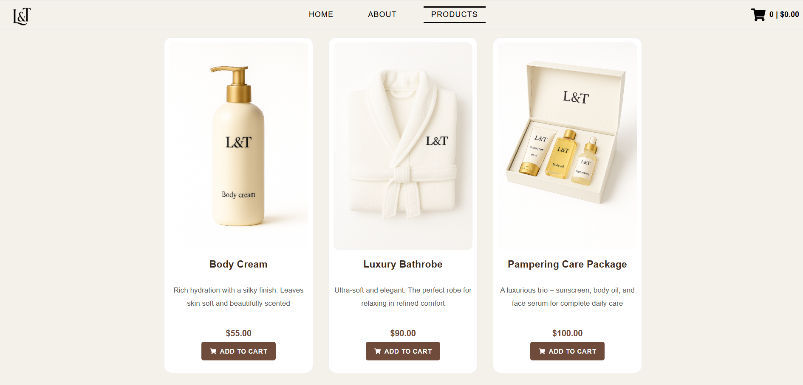
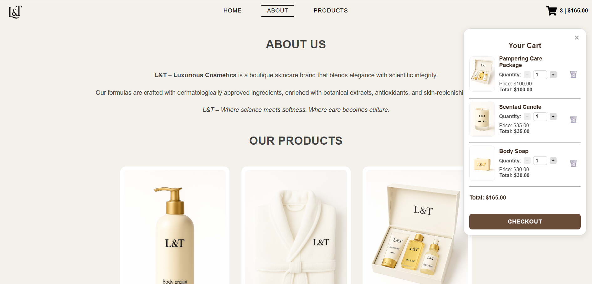
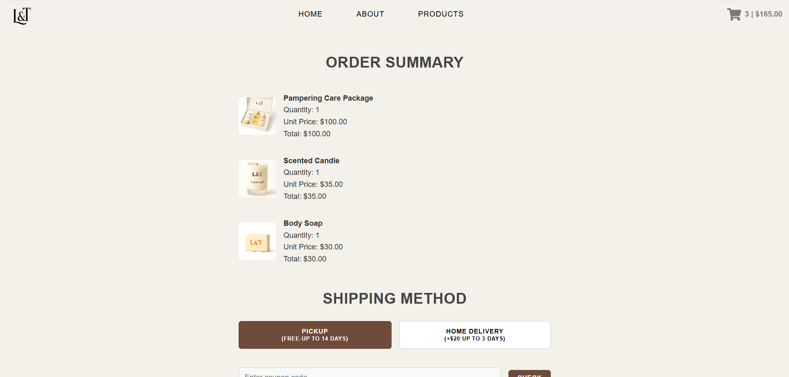
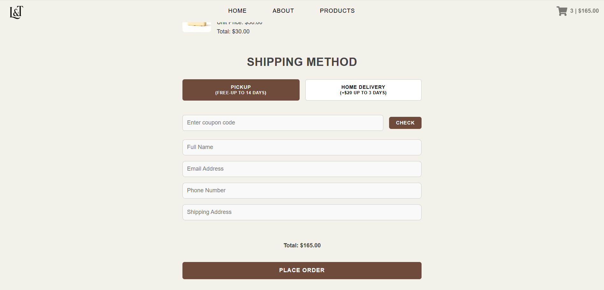
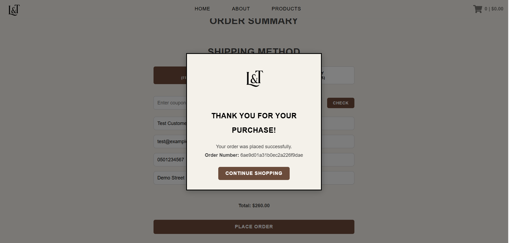

# L&T – Online Cosmetics Store

A full-stack online cosmetics store built with React, Node.js, Express, and MongoDB.

The application allows customers to browse skincare products, manage their shopping cart, choose a shipping method, and place orders. Product information is retrieved from MongoDB, and orders are stored through a REST API.

## Features

### Product Catalog
- Display products retrieved from MongoDB.
- Reusable React components for product cards.
- Loading and error handling when fetching products.
- Product images stored locally in the frontend.

### Shopping Cart
- Add and remove products.
- Update product quantities.
- Automatically calculate cart totals.
- Save cart items in localStorage so they remain after refreshing the page.
- Animated add-to-cart interaction.

### Checkout
- Order summary with products, quantities, and prices.
- Customer details form with input validation.
- Pickup or home delivery options.
- Free-shipping coupon support.
- Automatic calculation of shipping costs and order totals.
- Order submission to the backend.
- Order confirmation displaying the generated order ID.

## Tech Stack

| Frontend | Backend | Database |
|---|---|---|
| React | Node.js | MongoDB |
| JavaScript | Express.js | Mongoose |
| HTML & CSS | REST API | |
| React Router | | |
| Axios | | |

## Project Structure

```text
Online-Store/
├── Client/
│   ├── public/
│   │   └── images/
│   │       └── products/
│   ├── src/
│   │   ├── App.js
│   │   ├── Cart.js
│   │   ├── Navbar.js
│   │   ├── ProductCard.js
│   │   ├── OrderPage.js
│   │   └── OrderSuccessModal.js
│   └── package.json
├── Server/
│   ├── models/
│   ├── routes/
│   │   ├── products.js
│   │   └── orders.js
│   ├── server.js
│   └── package.json
├── screenshots/
├── products.json
└── README.md
```

## API Endpoints

| Method | Endpoint | Description |
|---|---|---|
| GET | `/products` | Retrieve all products from MongoDB |
| POST | `/orders` | Validate and save a new order |
| GET | `/` | Check the server response |

A successful order submission returns HTTP status `201` and the generated order ID.

## Running the Project Locally

### Requirements

- Node.js and npm
- MongoDB (local installation or MongoDB Atlas)
- Git

### 1. Clone the Repository

```bash
git clone https://github.com/LiorAb1/Online-Store.git
cd Online-Store
```

### 2. Configure the Backend

Open the server directory and install dependencies:

```bash
cd Server
npm install
```

Create a `.env` file inside the `Server` directory:

```env
MONGO_URI=mongodb://127.0.0.1:27017/shop
PORT=5000
```

The example above uses a local MongoDB database named `shop`.

If using MongoDB Atlas, replace `MONGO_URI` with your own connection string. Never commit your `.env` file or database credentials to GitHub.

### 3. Import Sample Products

The repository includes a `products.json` file containing nine sample products.

To import the products:

1. Open MongoDB Compass and connect to your MongoDB instance.
2. Select or create a database named `shop`.
3. Select or create a collection named `products`.
4. Click **Add Data → Import JSON or CSV file**.
5. Select `products.json` from the repository's root directory.
6. Complete the import.

Make sure the database name matches the database specified in `MONGO_URI`.

Product images are stored in:

`Client/public/images/products/`

The sample product records reference these images using local paths, so no external image hosting service is required.

### 4. Start the Backend

Make sure MongoDB is running, then execute:

```bash
node server.js
```

When the database connection is successful, the terminal displays:

```text
Connected to MongoDB
Server running on port 5000
```

The backend runs at:

`http://localhost:5000`

### 5. Start the Frontend

Open a second terminal from the repository's root directory:

```bash
cd Client
npm install
npm start
```

The React development server normally opens at:

`http://localhost:3000`

The frontend is configured to communicate with the backend at `http://localhost:5000`.

Keep both the frontend and backend servers running while using the application.

## How It Works

The React frontend sends requests to the Express backend, which retrieves product information from MongoDB using Mongoose.

Customers can browse products, add them to their cart, and adjust quantities. Cart data is stored in localStorage to preserve the shopping cart between page refreshes.

During checkout, customers enter their details, select a shipping method, and submit an order. The backend validates required information and saves the order in MongoDB.

After successful submission, the application displays an order confirmation with the generated order ID and clears the shopping cart.

## Screenshots

### Homepage


### Product Catalog



### Shopping Cart



### Order Summary



### Checkout



### Order Confirmation



## Possible Improvements

- User authentication and order history.
- Admin dashboard for product and order management.
- Server-side verification of product prices and shipping discounts.
- Inventory management.
- Online payment integration.
- Deployment to a cloud hosting service.
